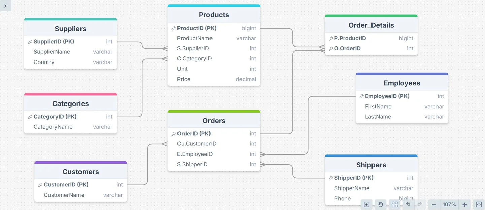

# 🗂 Kiwilytics ERD — Sales Database Design

Entity Relationship Diagram for a sales and order‑management database: who supplies which products, who ordered what, which employee handled it, and how it shipped.

`Data Modeling` · `ERD` · `SQL` · `Relational Design`

## Tables

| Table | Primary key | Holds |
|---|---|---|
| **Products** | `ProductID` | Product name, unit, price, supplier and category |
| **Suppliers** | `SupplierID` | Supplier name and country |
| **Categories** | `CategoryID` | Category name |
| **Orders** | `OrderID` | Customer, employee and shipper for each order |
| **Order_Details** | `ProductID` + `OrderID` | The products in each order |
| **Customers** | `CustomerID` | Customer name |
| **Employees** | `EmployeeID` | First and last name |
| **Shippers** | `ShipperID` | Shipper name and phone |

## Relationships

- **Suppliers → Products** (one‑to‑many): a supplier provides many products.
- **Categories → Products** (one‑to‑many): each product belongs to one category.
- **Customers → Orders** (one‑to‑many): a customer places many orders.
- **Employees → Orders** (one‑to‑many): an employee handles many orders.
- **Shippers → Orders** (one‑to‑many): a shipper delivers many orders.
- **Orders ↔ Products** (many‑to‑many), resolved through the **Order_Details** junction table.

## Why it's designed this way

- **Order_Details** breaks the many‑to‑many link between orders and products into two one‑to‑many links, so one order can hold many products and one product can appear in many orders.
- Lookup entities (suppliers, categories, customers, employees, shippers) live in their own tables, so names are stored once and referenced by key.
- The model is a clean star‑like base for reporting: **Orders / Order_Details** act as the fact side and the other tables as dimensions, which maps directly to a Power BI data model.

---

By **[Youssef Saeed](https://youssefsaeed1.github.io/portfolio/)** · [LinkedIn](https://www.linkedin.com/in/youssef-saeed1/)
